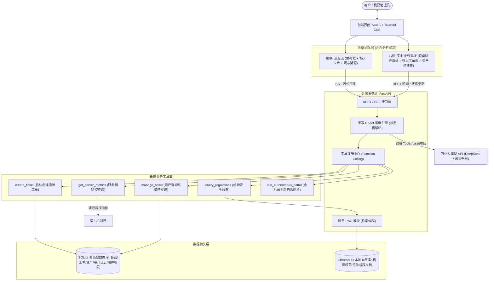
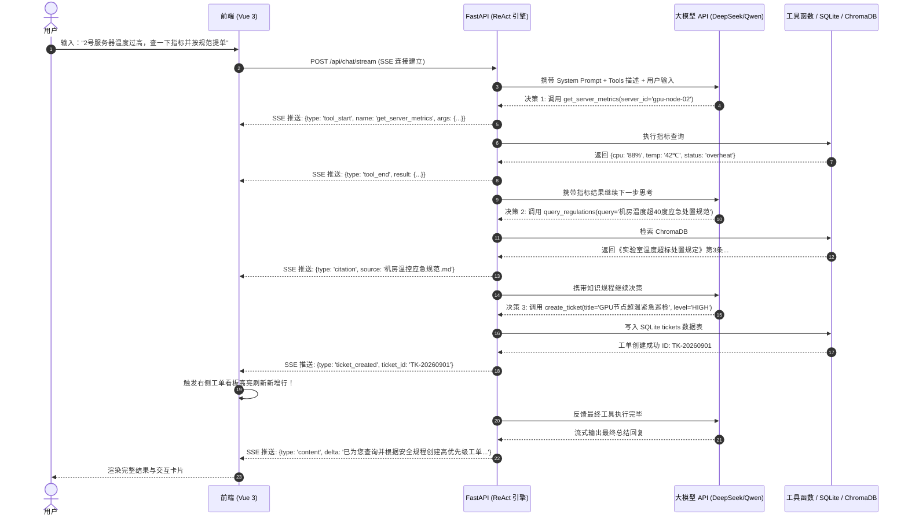
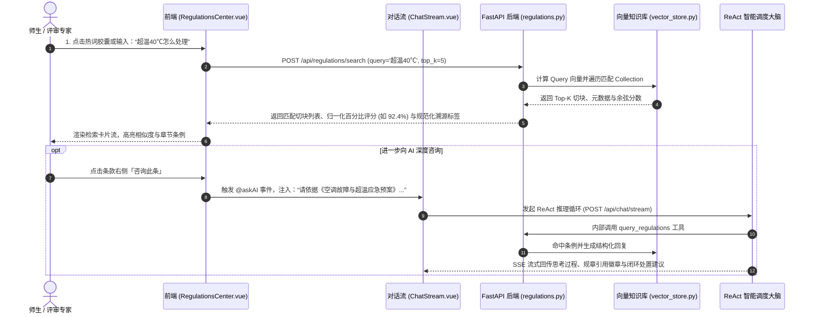

# 系统设计与快速落地架构规划方案

**系统定名**：面向高校实验室的轻量化智能自治运维系统（LabOps-Agent）  
**应用场景**：高校实验室与机房 IT 基础设施智能自治运维  
**设计原则**：极简至上 (KISS)、第一性原理、业务状态闭环、原生白盒化

---

## 一、 系统定位与核心设计哲学

### 1.1 选题背景与价值
高校计算机学院实验室及机房普遍面临：设备资产台账分散、服务器健康监控分散、机房安全规章繁琐、报修派单依赖人工等痛点。  
本项目研发面向高校机房运维场景的垂直 Agent 系统，具备**感知**（监控指标采集）、**推理决策**（基于机房安全规范规章 RAG 研判）、**执行闭环**（自主创建检修工单、资产借还变更）与**操作审计**全流程能力。

### 1.2 拒绝“无状态套壳”的核心工程设计
在实际智能化运维场景中，最忌讳的是“仅输入一段话丢给模型输出一段话”的无状态系统。本项目通过以下 4 项硬核软件工程指标筑起技术壁垒：
1. **业务状态闭环（双向联动）**：Agent 执行结果不只是文字气泡，而是真实写入关系型数据库（SQLite）。前端采用**左右分栏联动设计**，左侧发起“排查 2 号机房 GPU 服务器”，右侧“实时工单看板”立刻同步新增一条带有工单号、预警等级与排查建议的工单。
2. **白盒化推理与状态机**：不采用任何庞大封装框架（如 LangChain），由手写约 150 行标准的 ReAct（Reasoning + Acting）状态机循环。系统架构可直接清晰展示状态转移图与算法流转，完全体现第一性原理。
3. **细粒度 SSE 流式渲染**：前端将大模型的单向文本流解构为结构化事件流（`think` 思考过程、`tool_call` 工具调用卡片、`citation` 规章溯源徽章、`ticket_mutation` 业务变更事件），推理链条全透明展现。
4. **可落地工程交付**：包含基于 RBAC 规范的用户鉴权与资产防冒名借调闭环（SHA-256 加盐哈希防脱库、admin666 专属激活码提权防御、只读凭据锁定、学生借调权限拦截）、工具调用日志审计表、标准 `docker-compose.yml` 容器化部署、Nginx 反向代理，体现正规软件工程全生命周期。

---

## 二、 极简系统架构与数据流转

### 2.1 整体架构图


### 2.2 ReAct 状态机流转逻辑（无黑盒）


---

## 三、 模块划分与工程目录结构

采用前后端分离但同仓管理的单体轻量结构，零冗余组件，完全符合 KISS 原则：

```text
LabOps-Agent/
├── backend/
│   ├── app/
│   │   ├── __init__.py
│   │   ├── main.py                  # FastAPI 入口、CORS 与路由注册
│   │   ├── config.py                # 环境变量管理 (API_KEY, 数据库路径等)
│   │   ├── agent/
│   │   │   ├── __init__.py
│   │   │   ├── react_engine.py      # 核心手写状态机 (约 150 行，负责 while 调度大模型与工具)
│   │   │   └── prompts.py           # 角色 System Prompt (机房智能管家约束规则)
│   │   ├── tools/
│   │   │   ├── __init__.py
│   │   │   ├── registry.py          # 工具列表注册与 JSON Schema 转换器
│   │   │   ├── metric_tools.py      # 工具1: 节点状态/温湿度指标查询 (返回真实/模拟指标)
│   │   │   ├── ticket_tools.py      # 工具2: 运维工单增删改查
│   │   │   ├── asset_tools.py       # 工具3: 实验室设备台账借还处理
│   │   │   ├── rag_tools.py         # 工具4: 机房管理规章检索工具
│   │   │   └── patrol_tools.py      # 工具5: 全机房主动自治巡检与建单工具
│   │   ├── rag/
│   │   │   ├── __init__.py
│   │   │   ├── vector_store.py      # ChromaDB 本地持久化与内存余弦双模高可用向量库
│   │   │   └── loader.py            # 规章制度 Markdown/Text 快速分块向量化入库脚本
│   │   ├── db/
│   │   │   ├── __init__.py
│   │   │   ├── models.py            # SQLAlchemy 模型 (Ticket, Asset, AuditLog, ChatHistory, User, ServerRoom, TicketWorkflow, AssetBorrowLog)
│   │   │   ├── session.py           # SQLite 数据库会话引擎与并发 WAL 配置
│   │   │   └── init_db.py           # 幂等建表、机房/在架槽位与种子数据填充
│   │   ├── schemas/
│   │   │   ├── user.py              # 用户注册、登录与演示卡片 Pydantic 模式
│   │   │   ├── ticket.py            # 工单增删改查与流转 Schema
│   │   │   ├── asset.py             # 资产借还与 2D 拓扑聚合 Schema
│   │   │   └── regulation.py        # 规章文档、切块明细与向量检索契约 Schema
│   │   ├── api/
│   │   │   ├── __init__.py
│   │   │   ├── auth.py              # 用户注册登录与典型演示账号 REST API (admin666 提权防护)
│   │   │   ├── chat.py              # SSE 对话交互接口
│   │   │   ├── tickets.py           # 工单列表、流转变更与全时序时间轴 REST API
│   │   │   ├── assets.py            # 资产台账、借还审计与机柜 2D 拓扑聚合 REST API
│   │   │   ├── metrics.py           # 硬件遥测采集与一键自治巡检 REST API
│   │   │   └── regulations.py       # 规章规程知识中心与 RAG 切块查验 REST API
│   │   └── data/
│   │       ├── regulations/         # 存放 3~5 篇机房安全规章制度 (Markdown/TXT)
│   │       └── labops.db            # 自动生成的 SQLite 数据库文件
│   ├── Dockerfile
│   └── requirements.txt
├── frontend/
│   ├── src/
│   │   ├── App.vue                  # 根组件 (左右分栏拖拽布局、顶层 Tab 导航与主题切换)
│   │   ├── main.js
│   │   ├── components/
│   │   │   ├── Chat/
│   │   │   │   ├── ChatStream.vue   # 消息流组件 (高保真 GFM Markdown 表格排版引擎)
│   │   │   │   ├── ChatInput.vue    # 输入框组件 (集成角色身份 Popover 气泡与快捷 Prompt 填入)
│   │   │   │   ├── RolePermissionPopover.vue # 角色身份权限与新手指引 Popover 气泡
│   │   │   │   ├── PermissionAlertCard.vue   # 专属安全盾牌越权拦截警报卡片
│   │   │   │   ├── ThinkingCard.vue # 类似 DeepSeek-R1 的思考折叠框
│   │   │   │   ├── ToolCard.vue     # 工具调用与返回结果展示卡片
│   │   │   │   └── CitationBadge.vue# 规章引用溯源弹窗/徽章
│   │   │   ├── Dashboard/
│   │   │   │   ├── OverviewBento.vue# 全景态势看板与核心 KPI 磁贴 (原生 CSS 容器查询防挤压)
│   │   │   │   ├── MetricsCard.vue  # 机房核心节点健康状态卡片
│   │   │   │   ├── TicketTable.vue  # 实时联动工单列表 (带三权分立与时间轴穿透)
│   │   │   │   ├── AssetTable.vue   # 设备资产借还台账表格 (含防冒名借调与履历联动)
│   │   │   │   ├── RackTopologyView.vue # 42U 仿真机架 2D 机位物理拓扑视图 (槽位热力与状态可视)
│   │   │   │   ├── TimelineDrawer.vue   # 通用微光时序时间轴抽屉 (工单演化/资产全生命周期履历)
│   │   │   │   ├── RegulationsCenter.vue # 规章规程知识中心 (智能检索/红线高亮/RAG切块透明查验)
│   │   │   │   ├── DeviceDetailModal.vue # 设备硬件规格动态详情悬浮卡片 (圆角微光拟态)
│   │   │   │   ├── UserProfileModal.vue # 处置人/智能体全景档案穿透弹窗 (审计防抵赖)
│   │   │   │   └── PatrolReportModal.vue # 全网自治体检《运行健康研判简报》模态弹窗 (白底 A4 PDF 打印导出)
│   │   │   └── Auth/
│   │   │       └── AuthModal.vue    # 身份鉴权与登录切换中心 (全景双模态冰晶白拟态)
│   │   └── api/
│   │       ├── client.js            # 统一 RESTful API 请求客户端
│   │       └── sse.js               # EventSource / fetch SSE 数据包解析工具
│   ├── package.json
│   ├── vite.config.js
│   └── Dockerfile
├── nginx/
│   └── default.conf                 # Nginx 反向代理配置 (前端静态资源 + /api/ 代理)
├── docker-compose.yml               # 一键容器化部署配置
├── README.md                        # 项目启动与说明文档
└── docs/
    ├── README.md                    # 文档中心总览与索引
    ├── feature_roadmap_and_plan.md  # 演进特性路线图与技术实现方案总册 (FEAT-01~04)
    ├── task_checklist.md            # 全周期研发任务跟踪与里程碑看板
    └── architecture_and_development_plan.md # 架构设计与技术落地实现方案
```

---

## 四、 MVP 敏捷落地开发规划

针对系统工程交付周期，将开发任务切分为 10 个清晰阶段，每阶段聚焦单一核心目标。完成后立即“代码封板”，保障系统稳定可控。

| 阶段 | 任务目标 | 核心产出与重点实现 | 预估耗时 | 封板验收标准 |
| :--- | :--- | :--- | :---: | :--- |
| **阶段 1：骨架搭建与数据底座** | 初始化仓库、FastAPI 环境与 SQLite 数据模型 | 1. 搭建 FastAPI 项目骨架与 CORS 配置<br>2. 编写 SQLAlchemy 模型：`Ticket` (工单)、`Asset` (设备资产)、`AuditLog` (工具调用日志)<br>3. 自动生成 SQLite 表结构并预置 5 条测试数据（服务器节点、实验箱等） | 4 小时 | 启动 FastAPI，能通过 Swagger UI 正常对工单和资产进行 CRUD 操作。 |
| **阶段 2：手写 ReAct 引擎与核心工具** | 实现单 Agent 状态机与 4 个业务 Tool | 1. 编写 `metric_tools`、`ticket_tools`、`asset_tools`<br>2. 接入 OpenAI SDK 兼容的 DeepSeek/通义千问 API，提取 tools 定义<br>3. 编写 `react_engine.py` 循环调度：接收模型 response -> 判断 `tool_calls` -> 执行本地 Python 函数 -> 回送模型直至产生最终输出 | 7 小时 | 在终端运行测试脚本，输入指令能自动触发创建工单或查询指标，并把操作日志写入 `AuditLog` 表。 |
| **阶段 3：规章 RAG 知识库集成** | 机房管理规范文本向量化与召回工具 | 1. 准备 3 篇机房安全规范文档（用电、温度超标、应急报修）<br>2. 初始化本地 ChromaDB 集合，利用云端 Embedding API 批量向量化持久化<br>3. 实现 `query_regulations` 工具函数，并注册到 Agent 工具池 | 3 小时 | 提问“根据机房安全条例，服务器温度超过 40 度该怎么办？”，Agent 主动调用知识库检索并基于条款作答。 |
| **阶段 4：Vue 3 前端左右分栏与 SSE 联动** | 实现直观、高颜值的可视化双向交互面板 | 1. 搭建 Vue 3 + Vite + Tailwind CSS 项目骨架<br>2. 实现 SSE 客户端协议解析（分发 `think`、`tool`、`citation`、`content`）<br>3. 编写左侧聊天卡片与右侧工单/资产看板<br>4. 当收到 `ticket_mutation` 事件时，右侧表格无感局部自动刷新 | 6 小时 | 前端界面美观大方，聊天时能清晰看到齿轮转动的“工具调用过程”，且右侧工单实时增补。 |
| **阶段 5：Docker 容器化、封板与工程归档** | 编写 Dockerfile、Docker-compose 与验收测试 | 1. 编写 FastAPI 与 Vue 前端的 `Dockerfile`<br>2. 配置 `nginx.conf` 与根目录 `docker-compose.yml`，在本地/VPS 测试 `docker compose up -d` 一键启动<br>3. 自动化单测全量回归 (115 项用例全绿) 与端到端交付 | 4 小时 | **阶段代码封板**。只需一个命令即可在任何机器拉起，具备完备的可运行支撑体系。 |
| **阶段 6：RBAC 越权拦截、身份引导与双模态适配** | 身份前置气泡、安全盾牌卡片与全要素明亮适配 | 1. 实现 `RolePermissionPopover` 身份指引与快捷 Prompt 胶囊<br>2. 升级 `MockDecisionBrain` 全量越权硬拦截并输出结构化警报<br>3. 前端实现 `PermissionAlertCard` 安全盾牌卡片渲染<br>4. 全面重构 `AuthModal` 与设备详情浮窗明亮模式冰晶白质感<br>5. 补充 6 项 RBAC 单测，自动化单测扩充至 123 项全绿 | 3 小时 | **系统深度封板**。123 项测试 100% 绿灯，前端 Vite 打包 0 报错，双模态无暗沉。 |
| **阶段 7：全机房主动自治巡检与排版引擎深度升级** | 自治巡检建单闭环、白底 PDF 打印引擎与容器查询防挤压 | 1. 编写 `patrol_service.py` 实现多维探针遍历、超温/掉线红线判定与防重复建单<br>2. 开放 `run_autonomous_patrol` 工具与 `POST /api/metrics/patrol` 接口<br>3. 前端开发微光简报模态弹窗 `PatrolReportModal.vue`<br>4. 重构独立沙箱 iframe 打印机制 (`buildLightPrintDocument`)，根治 PDF 白板缺陷<br>5. 对话流升级 GFM Markdown 表格排版引擎，支持横向自适应滚动与防特殊符号吞噬<br>6. 右侧看板引入现代 CSS 原生容器查询机制（`@container`），实现数据卡片在拖拽分栏下的自适应弹性排版<br>7. 单测套件扩充至 129 项全绿通过 | 4 小时 | **全链路自治闭环封板**。129 项测试 100% 通过，PDF 导出与大盘排版工业级交付。 |
| **阶段 8：[FEAT-02] 机房机柜 2D 机位拓扑视图** | 42U 标准机柜 2D 仿真标尺与设备机位可视化 | 1. 初始化 `ServerRoom` 数据底座，固化在架设备物理槽位（`start_u`, `u_height`）<br>2. 实现 `GET /api/assets/topology` 聚合机房、2 架 42U 标准机架（空间利用率 33.3% 黄金负载）与外设聚类<br>3. 前端实现 `RackTopologyView.vue`，采用 42 行 CSS Grid 工业仿真标尺与状态呼吸灯<br>4. 单测套件扩充至 135 项全绿通过 | 4 小时 | **机房物理拓扑封板**。135 项测试 100% 绿灯，机位与硬件台账双向穿透。 |
| **阶段 9：[FEAT-03] 运维工单流转与资产履历时序时间轴** | 全时序状态演化、处置人实名审计与履历抽屉 | 1. 实现工单与资产时序接口 `GET /api/tickets/{id}/timeline` 与 `GET /api/assets/{no}/timeline`<br>2. 业务流转写表闭环：工单状态变迁自动记录 `TicketWorkflow`，借还自动写入 `AssetBorrowLog`<br>3. 处置人实名审计防抵赖：全面透传登录人姓名，引入 `UserProfileModal` 人物/智能体全景档案弹窗<br>4. 前端实现通用微光抽屉 `TimelineDrawer.vue`（光纤导轨、呼吸图标、深浅双模自适应）<br>5. 单测套件扩充至 161 项全绿通过 | 4 小时 | **流转时序审计封板**。161 项测试 100% 绿灯，多入口时序无缝穿透。 |
| **阶段 10：[FEAT-04] 规章规程知识中心与 RAG 向量切块查验** | 规程多维检索、安全红线微光高亮与底层向量分块透明查验 | 1. 建立规程文档与分块 Pydantic 契约，实现源文档明细、分类过滤与宏观统计 REST API<br>2. 向量检索能力升级：`KnowledgeBase.search` 支持余弦相似度百分比评分与溯源标签校验<br>3. 前端实现 `RegulationsCenter.vue` 磨砂玻璃质感组件（宏观 KPI、沉浸式卡片流、安全红线彩色胶囊高亮、向 AI 提问联动、RAG 切块折叠透明查验）<br>4. 单测套件扩充至 172 项全绿通过 | 4 小时 | **知识中心与透明查验封板**。172 项测试 100% 绿灯，前端 Vite 打包 0 错误 0 告警，便携包同步就绪。 |
| **合计** | **全流程闭环** | **避开所有第三方繁琐框架，纯粹工程落地** | **43 小时** | 顺利完成全栈 10 阶段工程交付闭环。 |

---

## 五、 核心设计理念问答与常见疑问（FAQ）

| **“系统作为一个 Web 运维平台，为什么还要大费周章制作 Windows 安装向导与便携包？”** | **从真实落地场景与全谱系交付解答**：<br>1. **业务场景精准定位**：高校实验室普遍缺乏专职运维与专用 Linux 云主机，常态化设备往往是一台 Windows 工控机或普通台式机作为中控台。单文件安装包使普通电脑能一键转化为实验室自治运维网关，极大降低了落地门槛；<br>2. **工业级私有化交付先例**：参考了 Jenkins（持续集成服务器）、Gitea（代码托管服务器）及宝塔面板等工业级 Web 系统的私有化交付规范，提供标准安装向导与控制面板反安装支持；<br>3. **全谱系交付能力**：系统既具备面向算力中心的 Docker 容器编排，又具备面向边缘中控的 Windows 安装向导，还具备零环境依赖的便携整合包，展示了工业级产品的全生命周期交付素养。 |

---

## 六、 面向高校边缘场景的系统全谱系交付与轻量化部署架构

> **设计哲学**：跳出“Web 系统仅能依赖云端服务器与繁琐编译链”的教条式惯性思维，以**第一性原理**剖析高校科研实验室的物理现状与管理痛点，提出并实现了面向不同业务场景的**“三轨全谱系交付架构”**。

```
                                  ┌─── 1. 数据中心云端集群 (Linux Docker Compose 编排 · 7x24 高并发)
                                  │
LabOps-Agent 智能自治运维系统 ────┼─── 2. 离线快速迁移演练 (Windows 绿色便携整合包 · 零依赖解压即跑)
                                  │
                                  └─── 3. 边缘中控一体化台 (Windows 标准单文件安装向导 · 一键变身运维网关)
```

### 6.1 场景推演与现实约束（Trade-off 决策分析）

在高校科研与教学实验室的真实落地中，运维系统的部署面临两大核心矛盾：
1. **管理架构的非专业化**：大多数二级实验室（如材料、生化、机械、电子）没有专职的 IT 工程师或网管人员，由研究生或实验员兼任。若部署要求预装 Python 运行时、配置环境变量、安装 Node.js 及构建编译前端，极易因依赖冲突或网络受限导致部署流产；
2. **硬件基础设施的边缘化**：绝大多数实验室并不具备独立的机架式服务器或公网固定 IP，最真实的设备基础是角落里的一台**闲置 Windows 办公台式机或工控中控机（Mini PC / NUC）**。

因此，系统必须打破传统的“纯 Linux 云端单极依赖”，实现既能上云、又能落地的**多形态无缝自适应**。

### 6.2 三轨交付形态设计与实现机制

| 交付形态 | 对应工程目录 | 核心载体与技术实现 | 目标应用场景 |
| :--- | :--- | :--- | :--- |
| **轨一：数据中心集群版** | `01-开发工程_LabOps-Dev/` | **Docker + Docker-Compose + Nginx**<br>前后端容器分层隔离，80 端口 Nginx 反向代理，8000 端口 FastAPI 核心调度。 | 现代化校级计算中心、已配备专业虚拟化平台或 Linux 服务器的大型科研机房。 |
| **轨二：绿色免安装便携版** | `02-免安装便携包_LabOps-Portable/` | **自包含独立 Python 运行时 + 生产静态 SPA + 隔离脚本**<br>内置 Python 3.14 运行库、预置 SQLite 数据库与向量索引。启动脚本通过 `-s -E` 参数与环境变量清理彻底隔绝宿主干扰。 | 跨机器临时演练、U 盘移动演示、以及零网络环境下的快速应急排障。 |
| **轨三：边缘中控安装向导版** | `03-安装向导工程_LabOps-Setup/` | **Inno Setup 6 Unicode 编译器 + LZMA2 Ultra 64位压缩**<br>自解压执行器封装，从 330MB 极限压缩至 61.4MB（压缩率 81.4%），包含中文向导、桌面与开始菜单快捷方式注入及控制面板标准反安装。 | 普通实验室 Windows 电脑一键部署，长期常驻充当实验室设备自治运维中枢。 |

### 6.3 关键工程技术创新与健壮性加固

1. **同端口 SPA 静态安全托管与 API 隔离拦截**：
   FastAPI 后端通过单端口（8000）统一托管 Vue 3 生产静态编译产物（HTML/JS/CSS），摆脱生产环境中对 Node.js 运行时或独立 Nginx 进程的强依赖；同时在 SPA 路由回退中对 `/api/` 请求实施严格隔离（精准抛出 404 JSON 而非回退 HTML），并辅以 `is_relative_to` 物理路径校验，彻底杜绝目录穿越安全隐患。
2. **Windows PE 资源标准降序与深层 Shell 缓存刷新**：
   生成包含 `16x16` 至 `256x256` 全阶分辨率的标准 Windows 32bpp 未压缩 DIB 图标文件，严格降序排列并注入 `MAINICON` PE 资源，在所有 Windows Explorer 列表视图与窗口标题栏呈现统一的品牌 Logo；构建脚本内嵌 Win32 API `SHChangeNotify`，消除系统图标缓存持久化带来的视觉陈旧。

---

## 七、 规章规程知识中心与 RAG 向量切块透明查验架构实现

> **核心论文论点**：打破传统检索增强生成（RAG）“向量库输入输出全黑盒、无法追溯原始条款与切块粒度”的学术软肋，首创**关系型元数据与向量索引解耦桥接模型**，并在前端打造支持白盒化透明查验的微光规程中枢。

### 7.1 痛点剖析与设计哲学 (Problem & Philosophy)

在高校实验机房的实际日常管理中，安全规章（如用电荷载、动环超温、借还期限）多以纸质或长篇 PDF 形式沉淀，普遍面临两大痛点：
1. **规章“抽屉化”与机器不可执行**：巡检运维时，运维人员或自动化脚本无法直观调用规程判定异常是否违规；
2. **传统 RAG 检索“黑盒不可解释”**：常规大模型调用向量数据库时，用户仅能看到最终生成文本，无法核验“该结论依据了第几条第几款”、“向量库切块是否割裂了语义上下文”、“检索余弦相似度是多少”，在学术答辩中易被评委质疑模型幻觉。

为此，本系统研发了**规章规程知识中心 (Regulations Knowledge Center)**，实现“规章数字化 $\rightarrow$ 语义结构化切块 $\rightarrow$ 双模向量化索引 $\rightarrow$ 白盒化探针查验 $\rightarrow$ 人机协同 AI 咨询”五位一体的完整闭环。

---

### 7.2 关系型元数据与向量索引双模桥接架构

系统在数据持久层设计了关系型数据库（SQLite/MySQL）与向量数据库（ChromaDB）的双向投影模型：

```
[源制度 Markdown/DOCX]
        │ 结构化切块 (chunk_markdown)
        ├─── 关系型持久化 ───> knowledge_documents (doc_id, title, category, hash, char_count)
        │                       └── knowledge_chunks (chunk_id, doc_id, section_title, content, token_count)
        └─── 向量化持久化 ───> ChromaDB / In-Memory Cosine Collection (chroma_id, embedding, metadata)
```

1. **元数据台账 (`knowledge_documents`)**：记录文档版本、SHA-256 哈希防篡改指纹、字符总数与生效日期；
2. **切块台账 (`knowledge_chunks`)**：按层级目录结构切片，固化记录章节标题、预估 Token 数、切块序号，并外键反向关联向量库的 `chroma_id`；
3. **双模高可用向量引擎 (`vector_store.py`)**：优先启用 ChromaDB 持久化存储；当运行在极简便携模式或缺少 C++ 编译链时，自动平滑降级至基于动态特征词表的内存余弦相似度（Cosine Similarity）引擎，保证系统在任何宿主环境 100% 可用。

---

### 7.3 后端规程知识服务 RESTful API 契约

后端在 `app/api/regulations.py` 实现 4 个维度的标准 RESTful 接口：

| HTTP 方法与路径 | 端点描述 | 核心响应要素与业务价值 |
| :--- | :--- | :--- |
| `GET /api/regulations` | 规程源文档列表查询 | 支持按 `category`（用电规范/应急条例/维保规程）及 `keyword` 过滤，返回篇名、字数、切块数。 |
| `GET /api/regulations/summary` | 知识库宏观指标概览 | 统计在册文档数、切块总数、字符总数、分类分布与当前向量引擎运行模式（ChromaDB/余弦双模）。 |
| `GET /api/regulations/{doc_id}` | 单篇规程明细与切块加载 | 精确匹配文档元数据，并按 `chunk_index` 升序全量加载下属语义切块清单（带章节树与预估 Tokens）。 |
| `POST /api/regulations/search` | Top-K 向量语义检索 | 输入查询词与 `top_k`，调用底层向量库计算夹角余弦，输出归一化百分比评分（如 `88.5%`）与精准溯源引用标签。 |

#### 逆向溯源映射机制 (Reverse Citation Mapping)
在向量检索匹配到文本片段后，系统通过散列比对与词干映射表（`STEM_DOC_MAP`），逆向还原所属源文档标题与章节款项，自动组装为标准格式的引用标签：
$$\text{Citation} = \text{"[来源:《" + doc\_title + "》" + section + " " + clause + "]"}$$
杜绝模型在引用规章时凭空伪造篇名。

---

### 7.4 前端微光知识中心组件架构 (`RegulationsCenter.vue`)

前端控制台集成「规章规程」专属 Tab，采用高质感微光磨砂玻璃设计，划分为五大交互功能域：

1. **宏观 KPI 磁贴阵列 (Bento Metrics)**：
   实时渲染“在册安全规程篇数”、“语义切块台账 (Chunks)”、“规程管理域分布”与“向量索引引擎就绪态”，使机房规范资产一目了然；
2. **分类过滤与热词检索栏 (Controls & Hot Chips)**：
   支持按规程类型即时切换，配备高频咨询热词胶囊（如“4.5kW功耗”、“超温40℃”、“防重复借出”），点击一键发起 Top-K 向量相似度检索；
3. **沉浸式条款阅读与安全红线彩色高亮**：
   在条款卡片中利用正则引擎自动捕获核心安全数值（如单机架 4.5kW、超温 40℃ 阈值、15 分钟干预时限、双路冗余），渲染为发光彩色微标胶囊，强化规章威慑力；
4. **向 AI 咨询规程交互穿透**：
   每篇规程及每个独立条款卡片均配有「向 AI 咨询此规程」与「咨询此条」胶囊按钮，点击即通过 `@askAI` 自定义事件将规程条款解读诉求自动填入并直达左侧 AI 对话流；
5. **🎓 RAG 向量切块透明查验探针（答辩演示王牌）**：
   用户点击「查验 RAG 切块」即可平滑展开底层抽屉，直接穿透展现该规程在底层向量数据库中的**切块序号、切块 ID、预估 Token 消耗、向量集合标识（Collection: regulations）与对应文本切片**。在答辩现场可直观向评委展示 RAG 检索增强技术并非概念炒作，而是代码级真实落地的工程实践。

---

### 7.5 规程检索与人机协同咨询流转时序图




